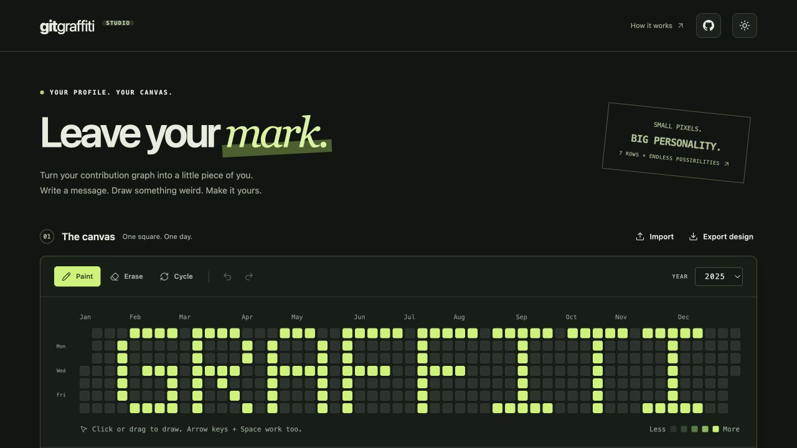

<div align="center">

[](https://github.com/ztxv/git-graffiti)


[](LICENSE)

# Git Graffiti

### Your profile. Your canvas. Leave your mark.

Turn your GitHub contribution graph into pixel art.<br/>
Write a message, paint a pattern, and generate the Git history behind it—all on your own machine.

[Quick start](#quick-start) · [Features](#features) · [How it works](#how-it-works) · [Publishing](#publishing) · [Development](#development)



</div>

## Why Git Graffiti?

Your contribution graph is already a grid of pixels. Git Graffiti gives you the tools to design it: a seven-row canvas, a pixel font, adjustable shades, and a local commit generator that follows the artwork you made.

- Stamp names, messages, and small Easter eggs in a 5×7 pixel font
- Paint directly on calendar dates with five shades, an eraser, and a cycling brush
- Undo a stroke, try a preset, or export a design to share
- Generate a separate repository from the exact design
- Work in dark or light mode with no account, OAuth, or API keys

> [!NOTE]
> The preview shows your design's planned commits. Existing GitHub activity and GitHub's contribution rules can affect the final appearance. Colors are illustrative.

## Quick start

You need **Node.js 22.12 or newer**, npm, and Git on your PATH.

```bash
git clone https://github.com/ztxv/git-graffiti.git
cd git-graffiti
npm ci
npm start
```

Open **[http://127.0.0.1:3000](http://127.0.0.1:3000)**. Keep the terminal running while you use the studio.

To use another port on macOS, Linux, or Git Bash:

```bash
PORT=4318 npm start
```

The server listens only on your machine. Dependencies require an internet connection to install; drawing and repository generation work offline afterward.

## Features

### A canvas made of dates

Choose a calendar year and paint its contribution graph. Columns are weeks; rows run from Sunday to Saturday. The editor accounts for leap years and partial weeks, and disables future dates.

| Tool | What it does |
| --- | --- |
| Paint | Applies the selected shade; click or drag across days |
| Erase | Clears painted pixels |
| Cycle | Steps through empty → shades 1–4 → empty |
| Stamp text | Replaces the canvas with a message aligned left, center, or right |
| Undo / redo | Restores strokes, stamps, imports, year changes, and cleared artwork |
| Import / export | Saves and loads a portable, validated JSON design |

Use **Tab** to enter the canvas, **arrow keys** to move, and **Space** or **Enter** to draw.

### Text and shades

The 5×7 font supports letters, digits, spaces, `! ? . - < > /`, and `♥`. Lowercase becomes uppercase. Each character uses five columns plus one separating column; text that does not fit is rejected without changing your artwork.

Four painted shades map to increasing commit counts. Defaults are **1, 3, 6, and 10 commits per day**. Adjust them under **Commit counts per shade**. Blank pixels produce no commits.

### A quiet, responsive workspace

- Dark mode by default, with a top-right light/dark toggle and GitHub link
- Theme preference and valid design drafts saved in the current browser
- Consistent Lucide icons and shared shadcn/Radix button controls
- Subtle Motion interactions and an animated generation progress bar
- Reduced-motion preferences respected across transitions and loading states
- Horizontally scrollable calendar on narrow screens

### Local repository generation

Enter your author name, a GitHub-linked email, and a new folder name. The app creates `generated/<folder>` with a `main` branch and the exact planned timestamps. Both author and committer dates are set; existing folders are never overwritten.

Generation displays progress and supports cancellation. A handled cancellation removes only the new partial repository.

## How it works

```text
Text stamp or freehand drawing
              ↓
       Pixel matrix (0–4)
              ↓
    Calendar dates + shade counts
              ↓
      Validated, stored commit plan
              ↓
       Local Git repository
              ↓
      Optional push to GitHub
```

The same calendar and design-validation module runs in the browser and server. The UI requests an exact preview plan and generation consumes its ID, keeping the generated commits tied to the design.

Commits are empty commits placed at noon UTC, one second apart per day. No extra initial commit is added. The result's working directory is empty because the artwork lives in its Git history.

## Publishing

The app displays a publishing command when generation finishes. Select **Public** or **Private**, then copy it into Bash, Zsh, or Git Bash.

Install [GitHub CLI](https://cli.github.com/) and authenticate once:

```bash
gh auth login
```

The generated command creates a new GitHub repository and pushes the local `main` branch. Choose an unused repository name; do not create the remote beforehand. The app itself does not authenticate, create remote repositories, or push automatically.

For contributions to count, use an email associated with your GitHub account and an eligible branch in a standalone repository. Review [GitHub's contribution rules](https://docs.github.com/en/account-and-profile/reference/profile-contributions-reference). Private contribution visibility depends on your profile settings.

## Hosted demo

The studio can be built as a static, server-free demo for hosts like Vercel. It's the same interface; the local API is replaced by an in-browser simulation, nothing is saved, and "Generate repository" only plays a mock progress bar.

```bash
npm run dev:demo     # try it locally at http://127.0.0.1:5173
npm run build:demo   # static site in dist/
```

To deploy on Vercel, import the repository and keep the defaults; `vercel.json` already sets the build command and output directory. The regular `npm run build` / `npm start` remain the real app.

## Link previews

Pasting the site into iMessage, Slack, Discord, X, or LinkedIn shows a branded card (`public/og-image.png`, 1200×630) with a title and description. Those come from the Open Graph and Twitter tags in [`index.html`](index.html). Crawlers don't run JavaScript, so the tags live in the static HTML, and the web manifest and app icons sit next to the image in `public/`.

- **Domain:** the `og:url`, `og:image`, `twitter:image`, and `canonical` URLs are absolute (`https://git-graffiti.vercel.app/…`) because relative URLs fail in iMessage. If you deploy under a different domain, update those four in `index.html`.
- **Re-render the image:** its source is [`scripts/og-image.html`](scripts/og-image.html). The comment at the top has a one-line Playwright command that writes `public/og-image.png`. Fonts are self-hosted subsets in `scripts/fonts/`, so rendering needs no network.
- **Caching:** apps cache previews per URL. After a redeploy, send the link with a throwaway ending such as `?v=2` to see the new card right away. Slack, Discord, X, and LinkedIn also have link-preview debuggers if one shows an old card.

## Technology

| Layer | Technology |
| --- | --- |
| Interface | React 19, Vite 7, Tailwind CSS 4 |
| Controls | shadcn/ui Button source, Radix Slot, class-variance-authority |
| Icons | Lucide React, Primer Octicons |
| Animation | Motion for React |
| Local API | Node.js HTTP server |
| Generation | Git CLI, executed with argument arrays |
| Persistence | Browser `localStorage`; JSON design files |
| Tests | Node.js built-in test runner and real temporary Git repositories |

## Development

```bash
npm run dev          # Vite on 5173 + local API on 3000
npm run build        # Build the production interface
npm run start:server # Serve the existing build
npm test             # Run the regression suite
npm run cli -- --preview # Preview the inherited CLI's random activity planner
```

Open [http://127.0.0.1:5173](http://127.0.0.1:5173) during development. Restart the development process after backend changes. `npm run lint` is the inherited Prettier command: it formats backend JavaScript in place rather than running a full-project lint check.

### Project structure

```text
shared/
  art.mjs                   Calendar, pixel font, validation, exact art plans
web/
  main.jsx                  Drawing, text, history, files, generation flow
  style.css                 Light/dark themes and responsive layout
  components/
    theme-toggle.jsx        Persistent theme switch
    interface-motion.jsx    Animated buttons and generation progress
    publish-instructions.jsx
    ui/button.jsx           Adapted shadcn/Radix button primitive
public/
  theme.js                  Theme selection before the first render
  favicon.*, icon-*.png     App icons; manifest.webmanifest and og-image.png
scripts/
  og-image.html             Source of the link-preview card (fonts/ holds its OFL subsets)
src/
  server.js                 Local API, preview storage, generation jobs
  repository.js             Git execution, identity, progress, cleanup
  planner.js                Retained random activity planner for the CLI
  cli.js                    Legacy command-line entry point
test/
  art.test.js               Calendar, font, validation, art API → Git tests
  history.test.js           Original engine, API, CLI, cancellation tests
```

## Local data and limits

| Item | Behavior |
| --- | --- |
| Draft and theme | Saved in this browser; no cloud sync |
| Author identity | Entered locally; not persisted by the UI |
| Design exports | Year, pixels, shade mapping, and format version only |
| Canvas | Usually 53 × 7; some leap years require 54 columns |
| Counts | Up to 100 commits per painted day and 25,000 per design |
| Generation | One running job per server |
| Preview storage | In memory; up to 20 previews, expiring after 30 minutes |
| Generated output | Independent repositories under `generated/`, ignored by Git |

## Current limitations

- Designs use a selected calendar year. Select that year on GitHub to view it; the default rolling view may crop older artwork.
- Existing contributions are not fetched or removed. They can fill blank pixels and change apparent shades.
- Changing years preserves week/weekday positions and clears unavailable pixels. Undo restores the previous design.
- Keep the generation page open. Refreshing does not reconnect to a running job; jobs are not restored after a server restart.
- An abrupt shutdown can leave a partial output folder. Choose a new folder name after inspecting it.
- Local Git output is tested. Actual GitHub profile rendering still needs verification through a real push.
- This application is intended for local use, not as an authenticated public service.

## Contributing

Focused fixes, pixel fonts, and editor improvements are welcome.

1. Fork the repository and create a branch for your change.
2. Run `npm test` and `npm run build`.
3. For interface changes, check both themes, desktop and mobile layouts, keyboard controls, and reduced motion.
4. Open a pull request describing the resulting behavior and how you verified it.

## Credits and license

Built on Git Larp and [artiebits/fake-git-history](https://github.com/artiebits/fake-git-history), originally created by Artur Khusaenov. Distributed under the [MIT license](LICENSE); retain the original copyright notice.

The header links to the project repository with the official [Primer Octicons GitHub mark](https://primer.style/octicons/icon/mark-github-16/). The interface uses free, open-source assets: [Lucide](https://lucide.dev/guide/react) (ISC), [Primer Octicons](https://primer.style/octicons/) (MIT), [shadcn/ui](https://ui.shadcn.com/docs/components/button) (MIT), [Radix](https://www.radix-ui.com/primitives/docs/utilities/slot) (MIT), and [Motion](https://motion.dev/docs/react) (MIT). See [third-party notices](THIRD_PARTY_NOTICES.md).

---

<div align="center">

**Git Graffiti v0.1.0** · Built by [ztxv](https://github.com/ztxv)<br/>
A little less spreadsheet. A little more self-expression.

</div>
